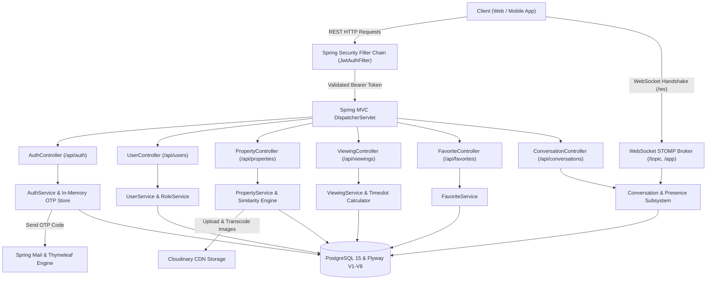

<div align="center">

# Real Estate Management Platform — Backend API Engine

### Enterprise-grade Spring Boot 4 REST & WebSocket backend powering real estate listings, timeslot-aware viewing appointments, Cloudinary media pipeline, and real-time buyer-seller consultations.

[](https://www.oracle.com/java/)
[](https://spring.io/projects/spring-boot)
[](https://www.postgresql.org/)
[](https://flywaydb.org/)
[](docs/API_GUIDE.md)
[](docs/SYSTEM_DESIGN.md)
[](https://cloudinary.com/)
[](docker-compose.yml)
[](LICENSE)

[Quickstart](#quickstart) · [System Highlights](#system-highlights) · [System Architecture](#system-architecture) · [Documentation Hub](#documentation-hub) · [Deployment](#deployment) · [API Playground](#api-playground) · [License](#license)

</div>

---

> [!IMPORTANT]
> **Production Runtime Notice:** The backend service requires Java 21+ and a running PostgreSQL 12+ database (provisioned automatically when using Docker Compose). Sensitive credentials including the JWT secret key (minimum 256 bits), SMTP mail credentials (for OTP emails), and Cloudinary API credentials must be configured in `.env.development` or `.env.production` before launching the application.

---

## System Highlights

| Capability | Module | Technical Description |
| :--- | :--- | :--- |
| **Authentication & Session Security** | `auth_service` | Dual-token authentication with stateless HMAC-SHA256 JWT Access Tokens and persistent Refresh Tokens stored in PostgreSQL. Features in-memory rate-limited OTP email verification via Thymeleaf HTML templates. |
| **User Directory & Role Hierarchy** | `user_service` | 4-tier Role-Based Access Control (`ROLE_USER`, `ROLE_OWNER`, `ROLE_AGENT`, `ROLE_ADMIN`). Supports instantaneous self-upgrade to Owner and formal verification request review workflows for Agent candidates. |
| **Property Listing & Media Pipeline** | `property_service` | Full property catalog management supporting multi-criteria filtering (location, price, area, bedroom/bathroom count), slug generation, similarity algorithms, view counters, and multi-image uploads to Cloudinary CDN. |
| **Viewing Appointment Scheduler** | `viewing_service` | Automated property showing management with conflict-free daily timeslot availability checks, complete status transition engine (`PENDING`, `CONFIRMED`, `REJECTED`, `RESCHEDULED`, `COMPLETED`, `CANCELLED`). |
| **Real-Time Property Inquiries** | `conversation_service` | Property-scoped communication channel connecting prospective buyers with owners or listing agents. Powered by WebSocket STOMP messaging, real-time presence indicators, unread badges, and message edit/recall capabilities. |
| **Wishlist & Saved Properties** | `favorite_service` | Quick-access bookmarking engine enabling users to save properties, check bookmark status in $O(1)$ database index lookups, and perform batch removals. |

---

## System Architecture

The platform operates an integrated Spring Boot architecture combining RESTful endpoints for transactional workflows and a WebSocket STOMP broker for real-time engagement:



---

## Quickstart

### Prerequisites

- **Java Development Kit (JDK)**: 21 or higher (or run entirely inside Docker)
- **Apache Maven**: 3.8+ (Maven Wrapper `./mvnw.cmd` / `./mvnw` is included)
- **PostgreSQL**: 12+ (or Docker Compose service)
- **Cloudinary Account**: Cloud name, API Key, and Secret (for image uploads)
- **SMTP Mail Provider**: Gmail App Password or standard SMTP relay (for OTP verification)

### 1. Repository Setup

Clone the repository and navigate into the workspace:

```bash
git clone https://github.com/hoangbmt023/qlbds.git
cd qlbds
```

### 2. Environment Configuration

Create `.env.development` in the project root directory:

```properties
# Database Configuration
DB_URL=jdbc:postgresql://localhost:5432/bds_db
DB_USERNAME=postgres
DB_PASSWORD=your_postgres_password

# JWT Security
JWT_SECRET=your_very_long_secret_key_that_should_be_at_least_256_bits_long

# SMTP Mail (Gmail App Password)
MAIL_USERNAME=your_email@gmail.com
MAIL_PASSWORD=your_app_password

# Cloudinary Media Storage
CLOUDINARY_CLOUD_NAME=your_cloud_name
CLOUDINARY_API_KEY=your_api_key
CLOUDINARY_API_SECRET=your_api_secret

# Default Initial Administrator
ADMIN_USERNAME=admin
ADMIN_PASSWORD=admin123
ADMIN_EMAIL=admin@qlbds.com
```

> [!NOTE]
> All `.env.*` files are untracked by Git to protect sensitive credentials.

### 3. Execution

Launch the application using either the included Maven Wrapper or Docker:

```bash
# Option A: Run locally using Maven Wrapper (Windows PowerShell)
./mvnw.cmd spring-boot:run

# Option A: Run locally using Maven Wrapper (Linux / macOS)
./mvnw spring-boot:run

# Option B: Run full container stack (API + PostgreSQL) via Docker Compose
docker-compose up -d
```

The application starts on `http://localhost:8080`.

---

## Documentation Hub

| Document | Scope | Description |
| :--- | :--- | :--- |
| [System Design](docs/SYSTEM_DESIGN.md) | Technical Architecture | Technical breakdown of service modules, real-time WebSocket STOMP design, ERD entity relationships, and state machine lifecycles. |
| [Setup Guide](docs/SETUP_GUIDE.md) | Operations & Deployment | Step-by-step developer environment setup, database Flyway migrations, Cloudinary CDN configuration, and environment dictionary. |
| [API Guide](docs/API_GUIDE.md) | Integration & Contracts | Swagger UI documentation, JWT Bearer flow, response envelopes, error handling, and complete REST endpoint catalog. |
| [Business Flows](docs/BUSINESS_FLOWS.md) | Operational Workflows | End-to-end user journeys (Buyer discovery, appointment negotiation, property publishing, real-time inquiries, role escalation) with sequence diagrams. |
| [Testing Guide](docs/TESTING_GUIDE.md) | Quality Assurance | Test pyramid, JUnit 5 & Mockito test suite breakdown, service coverage matrices, and execution commands. |
| [CI/CD Guide](docs/CICD_GUIDE.md) | Automation & Release | GitHub Actions continuous integration with PostgreSQL test containers and continuous deployment Docker Hub pipelines. |

---

## Deployment

### Option 1: Docker Compose (Recommended for Production)

Deploy both the backend API and PostgreSQL database with persistent storage:

```bash
# Start all services in detached mode
docker-compose up -d

# Follow application logs
docker-compose logs -f app

# Stop the stack
docker-compose down
```

### Option 2: Standalone Production JAR

Package and run an optimized production executable:

```bash
# Package executable JAR skipping unit tests
./mvnw.cmd clean package -DskipTests

# Launch JAR with Production profile
java -Dspring.profiles.active=production -jar target/QLBDS-0.0.1-SNAPSHOT.jar
```

### Option 3: Linux VPS (Systemd Service)

Create a dedicated Systemd unit file at `/etc/systemd/system/qlbds.service`:

```ini
[Unit]
Description=QLBDS Real Estate Management Platform API
After=network.target postgresql.service

[Service]
Type=simple
User=appuser
WorkingDirectory=/opt/qlbds
Environment="SPRING_PROFILES_ACTIVE=production"
ExecStart=/usr/bin/java -jar /opt/qlbds/QLBDS-0.0.1-SNAPSHOT.jar
Restart=always
RestartSec=10

[Install]
WantedBy=multi-user.target
```

Reload and activate the unit:

```bash
sudo systemctl daemon-reload
sudo systemctl enable --now qlbds
```

---

## API Playground

- **Swagger UI Interactive Explorer**: [http://localhost:8080/swagger-ui.html](http://localhost:8080/swagger-ui.html)
- **OpenAPI 3.0 Raw JSON**: [http://localhost:8080/v3/api-docs](http://localhost:8080/v3/api-docs)
- **Postman Collection**: Import [`docs/QL_BDS.postman_collection.json`](docs/QL_BDS.postman_collection.json) directly into Postman for comprehensive end-to-end request suites.

---

## License

This project is licensed under the MIT License. See [LICENSE](LICENSE) for full details.
