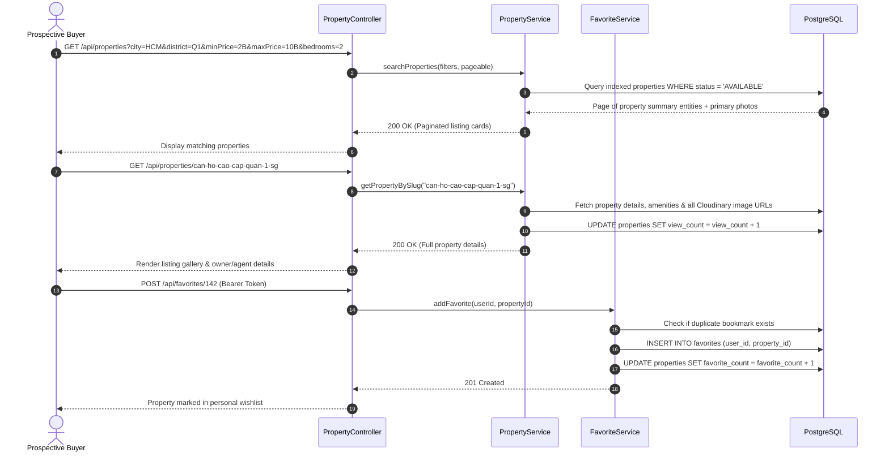
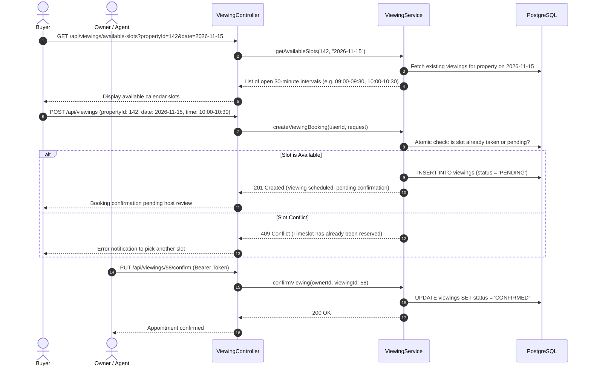
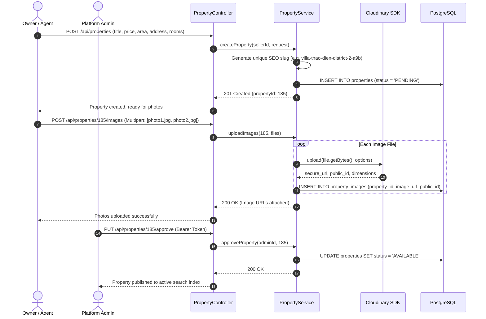
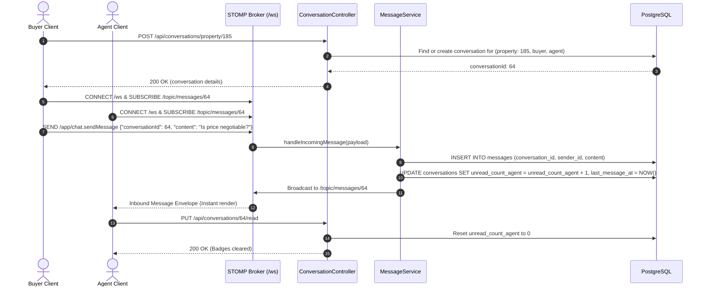
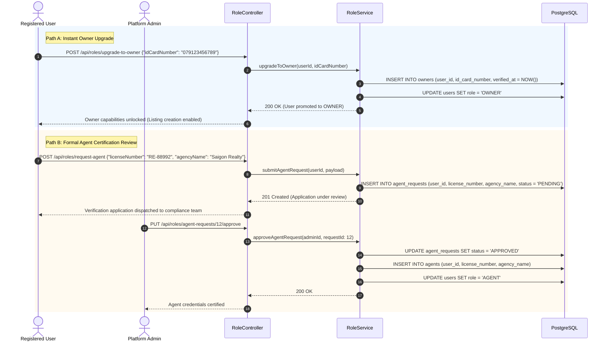

# Platform Business Flows & Operational Workflows

> Detailed walkthrough of core operational workflows and user journeys across the Real Estate Management Platform. Includes sequence diagrams, status transition matrices, and transactional validation rules.

---

## 1. Journey 1: Buyer Property Discovery & Wishlist Bookmarking

A prospective buyer or renter searches the public catalog, filters by granular specifications, examines listing details, and saves high-interest properties:

---

## 2. Journey 2: Viewing Appointment Booking & Conflict Management

The appointment engine ensures no two buyers can book conflicting timeslots for the same property:

---

## 3. Journey 3: Seller Listing Publication & Cloudinary Media Ingestion

Property owners and certified realtors upload new properties with photos and await administrative quality moderation:

---

## 4. Journey 4: Direct Real-Time Inquiry via WebSocket STOMP

Buyers and property managers communicate in real time regarding listing queries:

---

## 5. Journey 5: Role Escalation & Certification Workflow

The platform maintains distinct permissions between standard consumers and commercial actors:

