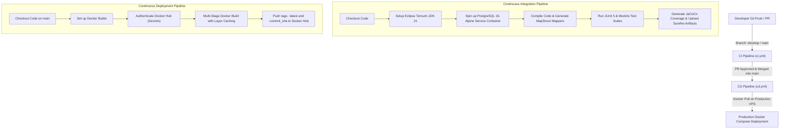

# CI/CD Automation & Deployment Guide

> Technical guide to continuous integration, automated testing via PostgreSQL service containers, multi-stage Docker builds, and automated Docker Hub release pipelines.

---

## 1. Automation Pipeline Architecture

The platform implements automated validation and delivery using **GitHub Actions**:



---

## 2. Continuous Integration Pipeline (`.github/workflows/ci.yml`)

The CI workflow triggers automatically upon:
- Push to `develop` or `main` branches.
- Pull Requests targeting `develop` or `main`.
- Manual trigger via `workflow_dispatch`.

### 2.1. Ephemeral PostgreSQL Service Container
To guarantee true-to-production testing conditions, the workflow boots an isolated PostgreSQL 15 instance:
```yaml
services:
  postgres:
    image: postgres:15-alpine
    env:
      POSTGRES_USER: test_user
      POSTGRES_PASSWORD: test_password
      POSTGRES_DB: test_bds_db
    ports:
      - 5432:5432
    options: >-
      --health-cmd pg_isready
      --health-interval 10s
      --health-timeout 5s
      --health-retries 5
```

### 2.2. Pipeline Execution Steps
1. **Repository Checkout**: Pulls latest revision using `actions/checkout@v4`.
2. **Java 21 Environment**: Configures Temurin JDK 21 with automatic Maven dependency caching.
3. **Compilation**: Runs `./mvnw clean compile` to validate syntax and generate MapStruct mapper implementations.
4. **Automated Test Run**: Executes `./mvnw test jacoco:report` with mock environment variables provided to prevent missing placeholder failures.
5. **Report Archival**: Uploads test logs and Surefire reports to GitHub Actions artifact storage (`target/surefire-reports/`).

---

## 3. Continuous Deployment Pipeline (`.github/workflows/cd.yml`)

The CD workflow automates container creation and distribution to Docker Hub upon code merges to `main`.

### 3.1. Required GitHub Repository Secrets

Configure the following secrets in **Settings > Secrets and variables > Actions**:

| Secret Name | Description | Example |
| :--- | :--- | :--- |
| `DOCKER_USERNAME` | Docker Hub account username | `hoangbmt023` |
| `DOCKER_PASSWORD` | Docker Hub Personal Access Token (PAT) | `dckr_pat_xxxx` |

### 3.2. Container Optimization & Tagging
- **Buildx & Layer Caching**: Employs Docker Buildx registry caching (`buildcache`) to minimize build times on recurring commits.
- **Dual Tagging**:
  - `latest`: Floating tag for the most recent production image.
  - `${{ github.sha }}`: Immutable commit-specific tag for auditability and rollback safety.

---

## 4. Production Deployment Execution

Once the CD pipeline publishes the latest image, production servers can be updated immediately:

```bash
# SSH into production host
ssh user@production-server.com
cd /opt/qlbds

# Pull latest container image from Docker Hub
docker-compose pull app

# Restart backend service with zero downtime migration
docker-compose up -d --no-deps app

# Confirm healthy startup
docker-compose logs -f app
```

