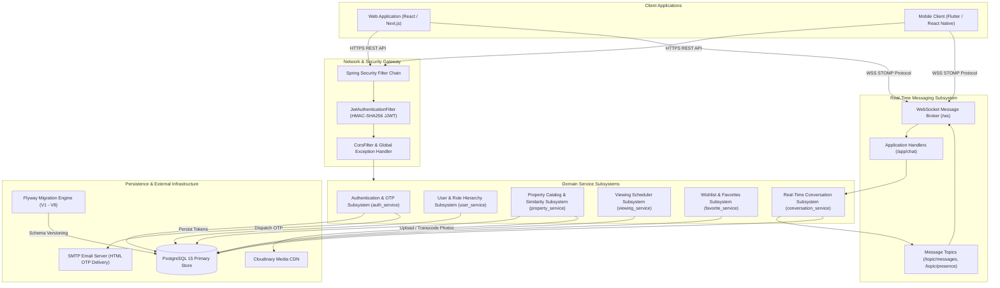
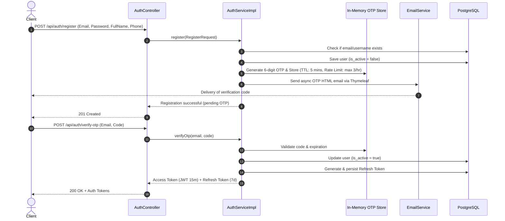
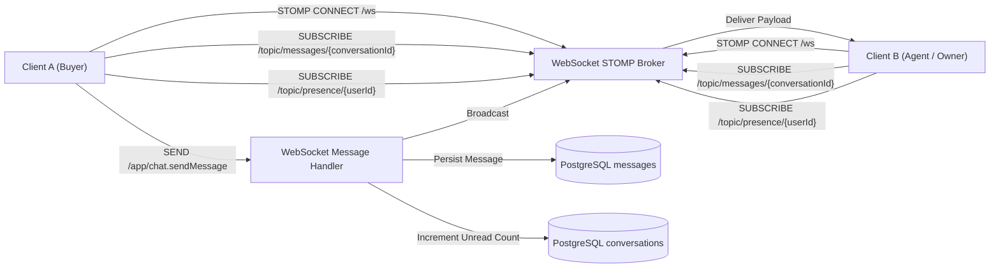
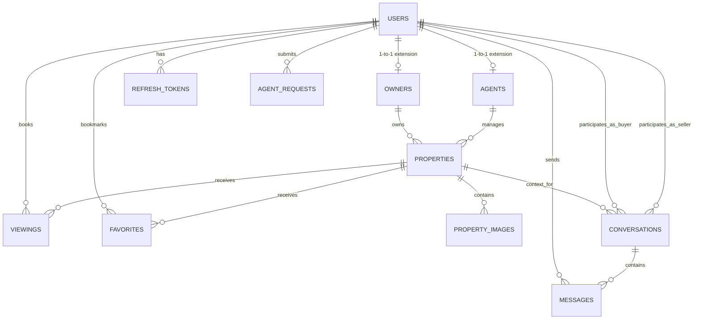
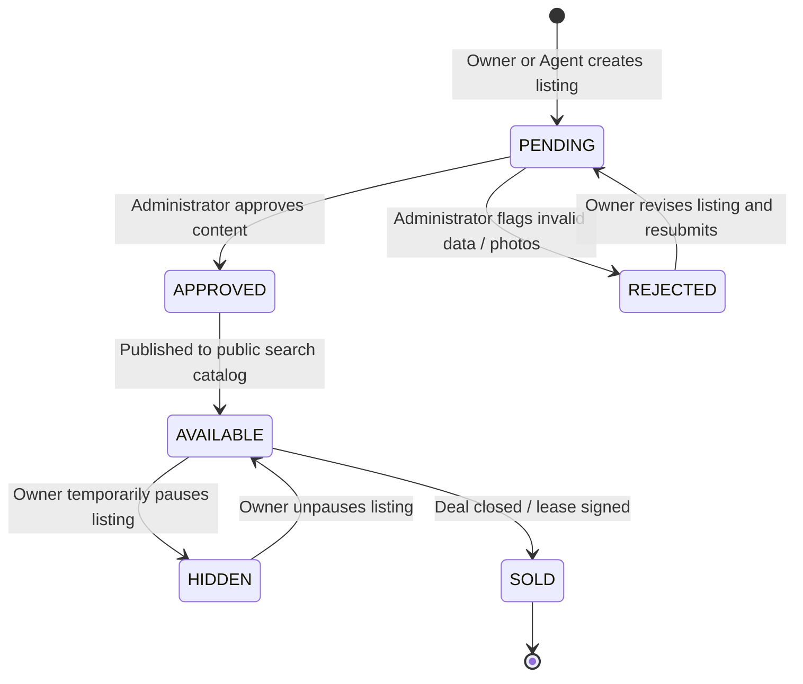
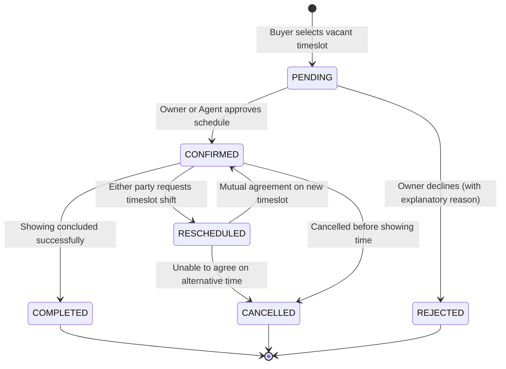
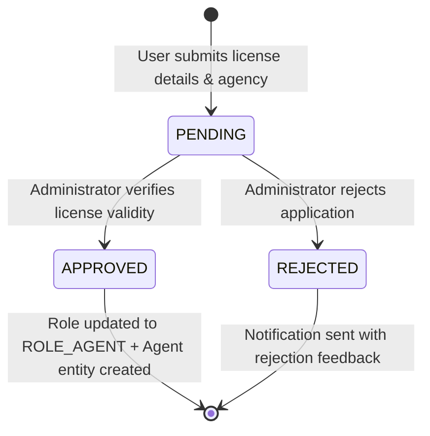

# System Design & Architecture Specification

> Comprehensive technical breakdown of the Real Estate Management Platform backend architecture, module responsibilities, real-time WebSocket messaging pipeline, relational database schema, and operational state machine lifecycles.

---

## 1. High-Level System Architecture

The Real Estate Management Platform backend is engineered as a high-throughput Spring Boot application running on Java 21. It combines stateless RESTful endpoints for transactional domain operations with an asynchronous WebSocket STOMP broker for real-time customer-agent communication.



---

## 2. Directory Structure & Module Responsibilities

The codebase organizes functionality across isolated functional service packages:

```
src/main/java/com/example/qlbds/
├── QlbdsApplication.java                 # Spring Boot application bootstrap entry point
├── config/                               # Infrastructure configuration beans
│   ├── CloudinaryConfig.java             # Cloudinary singleton client configuration
│   ├── SecurityConfig.java               # SecurityFilterChain, CORS, password encoder
│   ├── SwaggerConfig.java                # OpenAPI 3.0 documentation configuration
│   └── WebSocketConfig.java              # STOMP broker registration and endpoint mappings
│
├── common/                               # Cross-cutting utilities and infrastructure
│   ├── dto/                              # Standard API response wrappers (ApiResponse<T>)
│   └── exception/                        # GlobalControllerExceptionHandler and custom exceptions
│
├── shared/                               # Shared contracts and base entity models
│
├── auth_service/                         # Authentication & Security Subsystem
│   ├── controller/                       # /api/auth endpoints (register, login, OTP, refresh)
│   ├── service/                          # AuthService, EmailService, OtpRateLimiter, TokenProvider
│   ├── repository/                       # RefreshTokenRepository, User credential lookups
│   ├── entity/                           # RefreshToken entity
│   └── dto/                              # AuthRequest, RegisterRequest, VerifyOtpRequest
│
├── user_service/                         # User Directory & Role Escalation Subsystem
│   ├── controller/                       # /api/users endpoints
│   ├── service/                          # UserService, RoleService, AgentRequestService
│   ├── repository/                       # UserRepository, OwnerRepository, AgentRepository, AgentRequestRepository
│   ├── entity/                           # User, Owner, Agent, AgentRequest
│   └── dto/                              # UserResponse, UpdateProfileRequest, UpgradeRoleRequest
│
├── property_service/                     # Property Catalog & Media Subsystem
│   ├── controller/                       # /api/properties endpoints (search, CRUD, moderation)
│   ├── service/                          # PropertyService, PropertyImageService, SlugGenerator
│   ├── repository/                       # PropertyRepository, PropertyImageRepository
│   ├── entity/                           # Property, PropertyImage, PropertyCategory, PropertyStatus
│   └── dto/                              # PropertyCreateRequest, PropertySearchFilter, PropertyResponse
│
├── viewing_service/                      # Viewing Scheduler Subsystem
│   ├── controller/                       # /api/viewings endpoints
│   ├── service/                          # ViewingService, TimeslotAvailabilityCalculator
│   ├── repository/                       # ViewingRepository
│   ├── entity/                           # Viewing, ViewingStatus
│   └── dto/                              # BookingRequest, RescheduleRequest, ViewingResponse
│
├── conversation_service/                 # Real-Time Messaging Subsystem
│   ├── controller/                       # /api/conversations REST controllers
│   ├── service/                          # ConversationService, MessageService, PresenceService
│   ├── repository/                       # ConversationRepository, MessageRepository
│   ├── entity/                           # Conversation, Message
│   └── dto/                              # MessageSendRequest, MessageEditRequest, ConversationResponse
│
└── favorite_service/                     # Wishlist & Bookmarks Subsystem
    ├── controller/                       # /api/favorites endpoints
    ├── service/                          # FavoriteService
    ├── repository/                       # FavoriteRepository
    ├── entity/                           # Favorite
    └── dto/                              # FavoriteResponse
```

---

## 3. Authentication, Security & In-Memory OTP Subsystem

The security layer combines short-lived cryptographic tokens with an in-memory rate-limited OTP verification mechanism:



### In-Memory OTP Design & Anti-Abuse
- **Storage**: Held in a `ConcurrentHashMap` with thread-safe timestamp eviction.
- **Expiry Window**: 5 minutes from generation time.
- **Rate Limiting**: Sliding memory counter restricting each user to a maximum of 3 OTP requests within a 1-hour window to protect email quotas and mitigate spam attacks.
- **Token Security**: HMAC-SHA256 signed JSON Web Tokens using standard `jjwt-api` with a minimum 256-bit secret key.

---

## 4. Real-Time WebSocket STOMP Messaging Subsystem

The platform powers live inquiries directly between interested buyers and sellers/agents without third-party chat software:



### Protocol & Topic Structure
- **Connection Endpoint**: `/ws` (with SockJS fallback capability).
- **Application Destination Prefix**: `/app`.
- **Broker Destination Prefix**: `/topic`.
- **Subscribed Channels**:
  - `/topic/messages/{conversationId}`: In-flight message streaming, typing alerts, and edit/recall notifications.
  - `/topic/presence/{userId}`: Real-time user online/offline status notifications.

---

## 5. Database Architecture & Entity Relationships

The relational model is versioned using Flyway migrations (`V1` to `V8`), enforcing referential integrity and optimized indexing across all query patterns.

### 5.1. Entity Relationship Diagram (ERD)



### 5.2. Relational Schema Catalog

| Table | Primary Key | Foreign Keys | Key Attributes & Description |
| :--- | :--- | :--- | :--- |
| `users` | `id` (BIGSERIAL) | None | `username`, `email`, `password` (BCrypt), `full_name`, `phone`, `role` (`USER`, `OWNER`, `AGENT`, `ADMIN`), `is_active`, `is_deleted`. |
| `owners` | `id` (BIGSERIAL) | `user_id` -> `users(id)` | `id_card_number`, `verified_at`, `status`. One-to-one extension for property owners. |
| `agents` | `id` (BIGSERIAL) | `user_id` -> `users(id)` | `license_number`, `agency_name`, `rating`, `experience_years`. One-to-one extension for licensed realtors. |
| `agent_requests` | `id` (BIGSERIAL) | `user_id` -> `users(id)` | `license_number`, `agency_name`, `reason`, `status` (`PENDING`, `APPROVED`, `REJECTED`), `reviewed_by`. |
| `properties` | `id` (BIGSERIAL) | `owner_id` -> `owners(id)`, `agent_id` -> `agents(id)` | `title`, `slug`, `description`, `price`, `area`, `address`, `city`, `district`, `bedrooms`, `bathrooms`, `status`, `view_count`, `favorite_count`. |
| `property_images` | `id` (BIGSERIAL) | `property_id` -> `properties(id)` | `image_url` (Cloudinary URL), `public_id`, `is_primary`, `display_order`. |
| `viewings` | `id` (BIGSERIAL) | `user_id` -> `users(id)`, `property_id` -> `properties(id)` | `scheduled_date`, `start_time`, `end_time`, `status`, `notes`, `rejection_reason`. |
| `favorites` | `id` (BIGSERIAL) | `user_id` -> `users(id)`, `property_id` -> `properties(id)` | `created_at`. Unique constraint `(user_id, property_id)` prevents duplicate bookmarks. |
| `conversations` | `id` (BIGSERIAL) | `property_id` -> `properties(id)`, `user_one_id` -> `users(id)`, `user_two_id` -> `users(id)` | `last_message_at`, `unread_count_user_one`, `unread_count_user_two`. Unique composite index on `(property_id, user_one_id, user_two_id)`. |
| `messages` | `id` (BIGSERIAL) | `conversation_id` -> `conversations(id)`, `sender_id` -> `users(id)` | `content`, `is_read`, `is_edited`, `is_recalled`, `created_at`, `updated_at`. |
| `refresh_tokens` | `id` (BIGSERIAL) | `user_id` -> `users(id)` | `token`, `expiry_date`, `revoked`. |

### 5.3. Flyway Migration Version History

| Migration Script | Scope | Purpose |
| :--- | :--- | :--- |
| `V1__init.sql` | Core DDL | Establishes foundational schemas: users, owners, agents, properties, images, viewings, favorites, chat. |
| `V2__add_slug_to_properties.sql` | Property DDL | Adds unique SEO-friendly `slug` column to properties with index lookups. |
| `V3__add_refresh_token.sql` | Auth DDL | Establishes the `refresh_tokens` table for session longevity. |
| `V4__add_agent_request.sql` | User DDL | Adds `agent_requests` table to support the formal Realtor approval lifecycle. |
| `V5__add_soft_delete.sql` | Global DDL | Introduces `is_deleted` audit flags across entities to support non-destructive archiving. |
| `V6__update_properties.sql` | Property DDL | Adds `view_count`, `favorite_count`, and categorical indexing to properties. |
| `V7__update_conversations.sql` | Chat DDL | Adds conversation activity timestamp and unread badge counters. |
| `V8__update_messages_for_edit_recall.sql` | Chat DDL | Adds `is_edited` and `is_recalled` attributes supporting full messaging compliance. |

---

## 6. Operational State Machine Lifecycles

### 6.1. Property Listing State Lifecycle



### 6.2. Viewing Appointment State Lifecycle



### 6.3. Agent Certification Request Lifecycle



