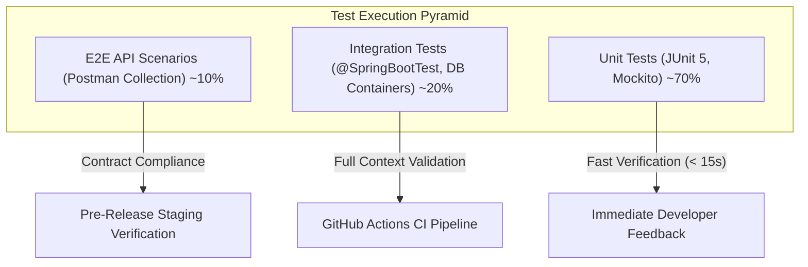

# Automated Testing & Quality Assurance Guide

> Verification strategy, test execution commands, Mockito isolation patterns, and service-by-service test case matrices for the Real Estate Management Platform.

---

## 1. Test Pyramid & Execution Strategy

The platform maintains an automated test suite prioritizing fast, isolated unit tests complemented by targeted integration tests:



### Coverage Thresholds
- **Class Coverage**: > 85%
- **Line Coverage**: > 80%
- **Branch Coverage**: > 75%

---

## 2. Test Execution Commands

The test suite is managed via Apache Maven. Tests can be executed globally or targeted to specific domains:

### 2.1. Run Full Test Suite
```bash
# Windows
./mvnw.cmd test

# Linux / macOS
./mvnw test
```

### 2.2. Run Tests for Specific Service Modules
```bash
# Run Authentication test suite
./mvnw.cmd test -Dtest="com.example.qlbds.auth_service.**.*Test"

# Run Property Management test suite
./mvnw.cmd test -Dtest="com.example.qlbds.property_service.**.*Test"

# Run Viewing Scheduler test suite
./mvnw.cmd test -Dtest="com.example.qlbds.viewing_service.**.*Test"

# Run Real-Time Messaging test suite
./mvnw.cmd test -Dtest="com.example.qlbds.conversation_service.**.*Test"

# Run User & Role Directory test suite
./mvnw.cmd test -Dtest="com.example.qlbds.user_service.**.*Test"
```

### 2.3. Run an Individual Test Method
```bash
./mvnw.cmd test -Dtest=AuthServiceImplTest#testLogin_ShouldReturnTokens_WhenCredentialsAreValid
```

---

## 3. Automated Test Suite Matrix

| Module | Test Class | Focus & Mocked Dependencies | Key Test Scenarios |
| :--- | :--- | :--- | :--- |
| **Auth** | `AuthServiceImplTest` | Mocks: `UserRepository`, `PasswordEncoder`, `JwtTokenProvider`, `EmailService` | • Valid registration with pending OTP<br>• Login success with token pair issuance<br>• Login failure with invalid password<br>• Refresh token rotation & revocation |
| **Auth** | `OtpRateLimiterMemoryTest` | In-memory sliding window verification | • Max 3 OTP requests allowed within 1 hour<br>• 4th OTP request rejected with 429 RateLimitException<br>• Counter reset after window expiration |
| **Auth** | `EmailServiceImplTest` | Mocks: `JavaMailSender`, `TemplateEngine` | • Thymeleaf template compilation<br>• HTML email dispatch with 6-digit verification code |
| **Property** | `PropertyServiceImplTest` | Mocks: `PropertyRepository`, `CloudinaryConfig`, `SlugService` | • Creation with auto-generated unique slug<br>• Multi-criteria filter query building<br>• Status transitions (`PENDING` -> `APPROVED` -> `AVAILABLE`)<br>• View counter increment on detail retrieval |
| **Viewing** | `ViewingServiceImplTest` | Mocks: `ViewingRepository`, `PropertyRepository` | • Available daily timeslot calculation<br>• Conflict rejection when timeslot is already booked<br>• Host confirmation & rejection workflows<br>• Reschedule negotiation lifecycle |
| **Chat** | `ConversationServiceTest` | Mocks: `ConversationRepository`, `MessageRepository`, `SimpMessagingTemplate` | • Unique conversation creation between buyer and host<br>• Message delivery & unread counter increment<br>• Message editing and recall audit flags<br>• Mark as read clears unread badges |
| **Presence**| `PresenceServiceTest` | In-memory presence tracker | • User connect broadcasts `ONLINE` to subscriber topic<br>• User disconnect broadcasts `OFFLINE` |
| **User** | `UserServiceImplTest` | Mocks: `UserRepository`, `PasswordEncoder` | • Profile retrieval and update<br>• Password change with old password verification |
| **Role** | `RoleServiceImplTest` | Mocks: `AgentRequestRepository`, `RoleRepository` | • Self-service Owner upgrade<br>• Agent verification submission and Admin approval |

---

## 4. Test Configuration & Mocking Isolation

### Mocking External Services
- **Cloudinary CDN**: Unit tests mock the Cloudinary uploader to prevent external network traffic or cloud credit consumption during test runs.
- **SMTP Mail Server**: The `JavaMailSender` bean is mocked, verifying that `send()` is invoked with the expected recipient and generated OTP code.
- **Database Isolation**: In-memory and test-slice configurations ensure test runs do not mutate existing development databases.

